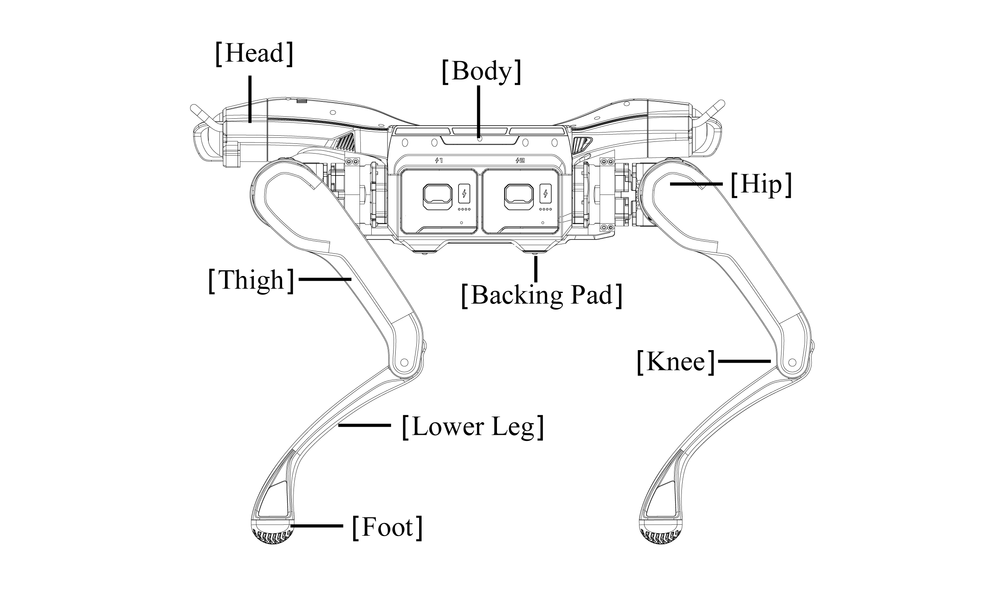
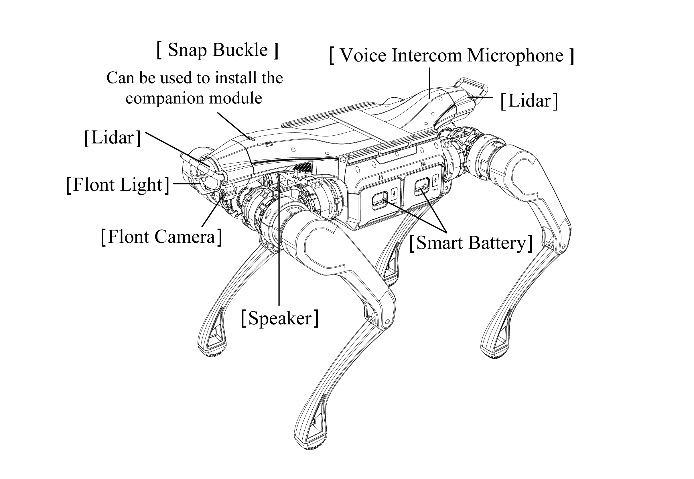
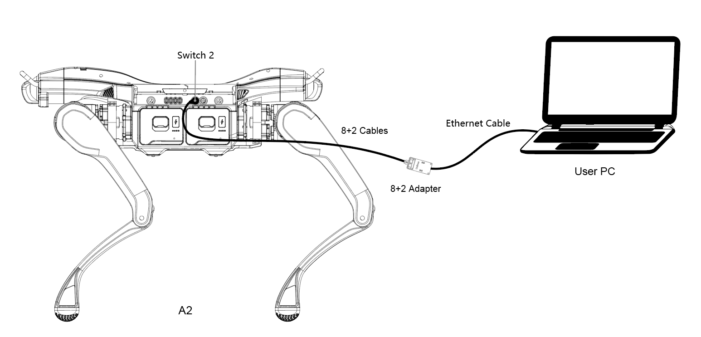
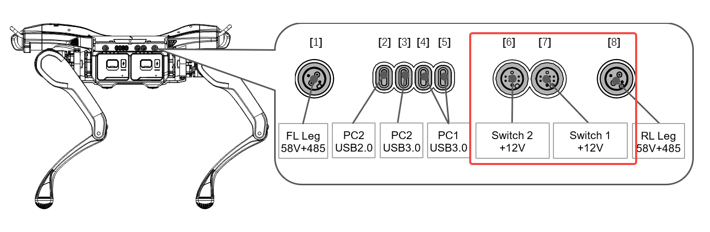
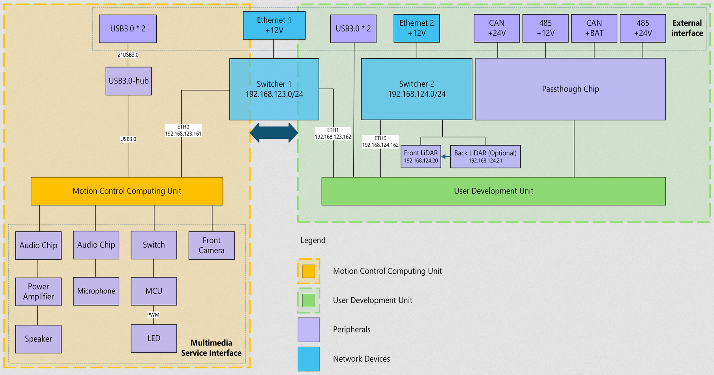
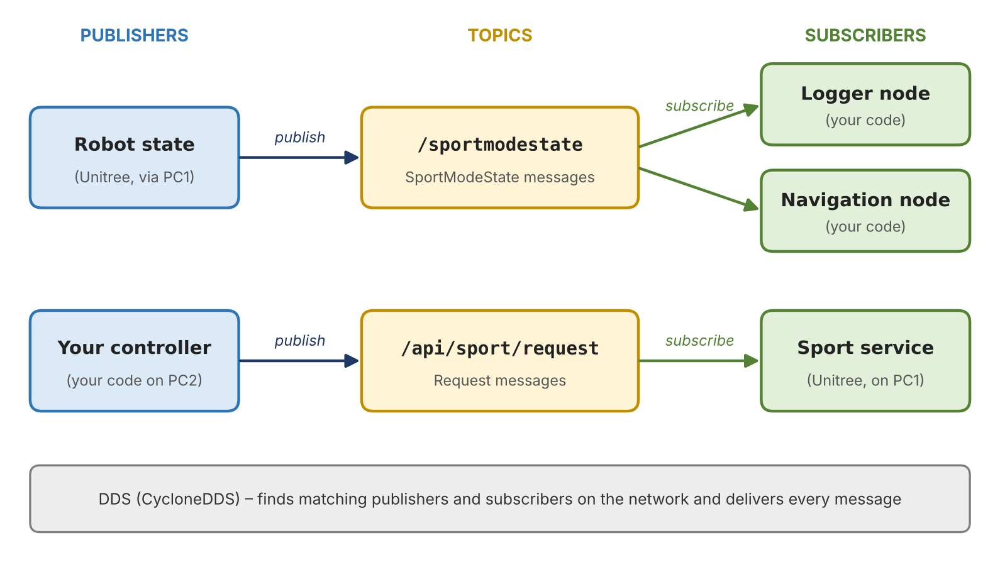

<p align="center"></p>

# Reboot Dog: Unitree A2 Pro User Guide

**Edge Hill University** · Version 1.0 · October 2026

Safety, robot overview, powering on, operation, sensors, onboard computers, networking, ROS 2 Humble, development environment setup and the Unitree SDK for the Edge Hill University Unitree A2 Pro quadruped robot.

## Document details

| Item | Detail |
|---|---|
| Robot | Unitree A2 Pro (legged) |
| Document version | 1.0 |
| Date | October 2026 |
| Intended readers | Staff and students operating or developing on the A2 Pro |

> [!CAUTION]
> **Read Section 1 before operating the robot**
>
> Nobody may operate, approach, lift or connect to the robot until they have read and understood the Health and Safety section of this guide.

## Contents

- [1. Basic Health and Safety](#1-basic-health-and-safety)
- [2. Robot Overview](#2-robot-overview)
- [3. Powering On the Robot and Remote](#3-powering-on-the-robot-and-remote)
- [4. The Remote Controller](#4-the-remote-controller)
- [5. Sensors](#5-sensors)
- [6. Onboard Computers: PC1 and PC2](#6-onboard-computers-pc1-and-pc2)
- [7. Network Setup](#7-network-setup)
- [8. ROS 2 Humble Overview](#8-ros-2-humble-overview)
- [9. Setting Up a Development Environment](#9-setting-up-a-development-environment)
- [10. Unitree SDK Overview](#10-unitree-sdk-overview)

## Key Contacts

Contact one of the people below with any questions, problems or requests about the robot, including permission to download software onto the development PC.

| Name | Role | Email |
|---|---|---|
| Michael Clayton-Brown | Technician | Brownmic@edgehill.ac.uk |
| Swagat Kumar | Lecturer | Kumars@edgehill.ac.uk |
| Cohben O'Brien | Document author | 26069199@edgehill.ac.uk |

## 1. Basic Health and Safety

The Unitree A2 Pro is a powerful, high-torque legged robot. Its joint motors can move quickly and with enough force to cause injury or damage. The rules in this section apply every time the robot is powered on, moved, charged, connected to or worked on.

### 1.1 Weight and lifting

The A2 Pro weighs approximately **37 kg with both batteries fitted** (about 31 kg without batteries). This is above the safe single-person lifting load.

> [!CAUTION]
> **Two-person lift**
>
> If the robot needs to be lifted or carried, it must ALWAYS be lifted by two people.

- Before lifting, put the robot into the locked/lying-down position and then damping mode, or power it off completely.
- Lift by the main body, one person at the front and one at the rear. Never lift by the legs, feet, LiDARs or camera.
- Agree the lift before starting (“ready, lift”), keep your back straight and bend at the knees.
- Keep fingers clear of the knee and hip joints, which are pinch points even when the robot is powered down.
- Removing the batteries reduces the weight by around 6 kg if a shorter carry is needed.

### 1.2 Exclusion zone during operation

> [!CAUTION]
> **2 metre safety distance**
>
> When the robot is in operation (standing, walking or running a program), it must be kept at least 2 metres away from all people and objects.

- Set up a clear operating area before the robot is stood up, and keep spectators behind the 2 m line.
- Robots can move unexpectedly when switching mode, standing up, recovering from a fall or running new code. Treat every transition as a hazard.
- Do not walk the robot towards people, walls, furniture, stairs or drops closer than 2 m unless this is the specific, risk-assessed task.
- Operate on flat, dry, non-slip ground unless testing terrain under supervision.

### 1.3 Locked position before approaching

Any time you need to go near the robot — to plug in or remove a cable, swap a battery, fit or remove a payload, check a sensor or anything else — the robot must first be put into the locked position.

1. Bring the robot to a stop with the joysticks centred.
1. Use the controller to put the robot into the **locked / lying-down** position (see [Section 4](#4-the-remote-controller)).
1. Confirm the robot is stationary and the joints are locked before stepping inside the 2 m zone.
1. Tell the operator you are approaching. The operator must not touch the controller while you are at the robot.
1. When you have finished and are back outside the 2 m zone, tell the operator it is clear to continue.

### 1.4 Emergency stop

There are two independent ways to stop the robot in an emergency:

| E-stop | Location | Use |
|---|---|---|
| Controller emergency stop | On the handheld remote controller | Primary stop for the operator. Puts the robot into damping mode so it lowers itself to the ground. |
| Robot emergency stop button | On top of the robot body | Physical stop for anyone near the robot, or if the controller fails or loses connection. |

- Everyone in the area must know where both emergency stops are before the robot is powered on.
- If anything unexpected happens — erratic movement, a person entering the zone, a fall, smoke or unusual noise — press the emergency stop immediately. Do not try to catch or hold the robot.
- After an emergency stop, keep clear until the robot is fully settled, then investigate before restarting.

### 1.5 General safety rules

- Never put hands, feet or clothing near the legs while the robot is powered and not locked.
- Keep all personnel clear during startup and when standing the robot up.
- Use a wired connection for anything that sends motion commands. A dropped Wi-Fi link can stall a control loop.
- If a laptop must ride on the robot while it moves, it must be secured with two proper retractable ratchet straps and the cable kept clear of the legs ([Section 9.8](#98-carrying-a-laptop-on-the-robot)).
- The handheld controller stays active while SDK/ROS programs run, and both sets of commands act together. Keep the controller with the operator at all times.
- When testing new code, start at low speed and keep a hand on the emergency stop.
- Check both batteries are fully latched before operation. Remove batteries for long-term storage and follow lithium-battery safety guidance.

### 1.6 Pre-operation checklist

| ✓ | Check |
|---|---|
| ☐ | Operating area is clear and at least 2 m around the robot is free of people and objects |
| ☐ | Both emergency stops located and everyone briefed |
| ☐ | Batteries charged and fully latched |
| ☐ | Legs in a natural, untangled position on flat ground |
| ☐ | Controller charged, paired and held by a trained operator |
| ☐ | PC1–PC2 aviation-plug Ethernet cable connected (see [Section 6](#6-onboard-computers-pc1-and-pc2)) |
| ☐ | Two people available if the robot needs to be moved |

## 2. Robot Overview

The Unitree A2 Pro is an industrial four-legged (quadruped) robot. It is built to carry sensors and payloads over ground that wheeled robots cannot handle, such as stairs, gravel, slopes and rough outdoor terrain, indoors or outdoors and in most weather.

### 2.1 What it is built to do

Typical applications for the A2 Pro include:

- Industrial inspection and security patrol, including autonomous routes
- Mapping and surveying using its two LiDARs (SLAM)
- Carrying equipment, tools and supplies on rough sites (logistics)
- Emergency-response and search development
- Robotics research, teaching and development

The A2 Pro adds a second (rear) LiDAR for 360° coverage, higher water and dust protection for its core parts, and options for GPS and 4G compared with the standard A2.

### 2.2 Key capabilities

| Capability | Specification |
|---|---|
| Weight | ≈37 kg with both batteries (≈31 kg without) |
| Size (standing) | 820 × 440 × 570 mm (L × W × H) |
| Walking speed | 0–3.7 m/s normal range, up to about 5 m/s maximum |
| Range (no payload) | About 20 km / 5 hours |
| Range (25 kg payload) | About 12.5 km / 3 hours |
| Step height | Up to 30 cm |
| Climb height | About 0.5–1 m |
| Slopes | Up to about 45° |
| Joints | 12 (3 per leg), up to 180 N·m torque |
| Weather protection | IP56 overall; core components (sensors and onboard PC) IP67 |
| Operating temperature | About −20 °C to 50 °C (sources quote up to 55 °C) |

*These are Unitree’s published figures. Real performance depends on terrain, payload, speed, temperature and how hard the onboard computers are working.*

### 2.3 Parts of the robot, range of motion and movement

Figure 1 shows the names used for the main parts of the A2 Pro. These names are used throughout this guide and in Unitree’s documentation and SDK.

<p align="center"></p>

<p align="center"><em>Figure 1: Main parts of the A2 Pro</em></p>

#### Main parts

| Part | Description |
|---|---|
| Head | Front end of the robot, carrying the front sensors (camera, light and front LiDAR). |
| Body | Central section housing PC1, PC2, the two battery bays (#1 and #2), the side-panel connectors and the emergency stop on top. |
| Hip | Joint where each leg attaches to the body. Swings the leg outwards and inwards (sideways). |
| Thigh | Upper leg, driven by a motor at the hip. Swings the leg forwards and backwards. |
| Knee | Joint between the thigh and lower leg. Bends and straightens the leg. |
| Lower leg | Lower section of the leg, from the knee to the foot. |
| Foot | Rubber foot with a ridged grip pattern that contacts the ground. |
| Backing pad | Pads on the underside of the body that the robot rests on when lying down. |

#### Joints and range of motion

Each leg has three motorised joints (hip, thigh and knee), giving 12 joints in total. The SDK names the legs FL, FR, RL and RR (front-left, front-right, rear-left, rear-right) and the joints hip, thigh and calf (knee).

| Joint | Movement | Range of motion | Max torque | Max speed |
|---|---|---|---|---|
| Hip | Leg swings out and in (sideways) | −58° to +58° (about 116°) | 120 N·m | 22 rad/s |
| Thigh | Leg swings forward and back | Front legs: −134° to +181°<br>Rear legs: −89° to +226°<br>(about 315° – almost a full turn) | 120 N·m | 22 rad/s |
| Knee (calf) | Leg bends and straightens | −159° to −31° (about 128°) | 180 N·m | 14.7 rad/s |

*Joint limits are from Unitree’s official A2 robot model (a2.urdf in the unitree_ros repository). Angles are measured from the model’s zero position for each joint. Always check limits against the SDK before sending low-level commands.*

The very large thigh range is what lets the A2 fold its legs to lie down, stand back up, and turn itself the right way up after a fall.

#### Movement capabilities

| Movement | Description |
|---|---|
| Walking | Forwards, backwards and sideways, and turning on the spot, all controlled by the joysticks. |
| Running | Faster gait for large, clear areas (up to about 3.7 m/s, maximum about 5 m/s). |
| Body posture | While standing, the body can lean (roll), tilt (pitch), twist (yaw) and raise or lower its height. |
| Gaits | Normal walking, running and endurance (energy-saving) gaits, with adjustable step height. |
| Stairs and obstacles | Steps up to 30 cm high and climbs of about 0.5–1 m. |
| Slopes | Up and down slopes of up to about 45°. |
| Lie down / stand up | Folds its legs to lie on the backing pads and stands back up. |
| Fall recovery | Can turn itself the right way up and stand after a fall. |

> [!CAUTION]
> **Pinch points and leg sweep**
>
> The hip, thigh and knee joints are strong pinch points. Because the thigh can rotate almost a full turn, the legs can sweep through a very wide area, especially when standing up, lying down or recovering from a fall. Never put hands, feet or clothing near the legs unless the robot is in the locked position ([Section 1.3](#13-locked-position-before-approaching)).

### 2.4 Payloads

| Load type | Limit |
|---|---|
| Continuous walking payload | About 25 kg |
| Maximum standing load | About 100 kg |

Examples of payloads the A2 Pro can carry:

- Extra sensors: thermal cameras, gas detectors, acoustic sensors, additional 3D LiDARs
- Survey equipment and extra computing (edge AI) units
- Radios and communications equipment
- Tools, spare parts and supplies
- A laptop for SLAM mapping or debugging, strapped down as described in [Section 9.8](#98-carrying-a-laptop-on-the-robot)

The robot provides power and data for payloads through its side and docking-station ports: 12 V, 24 V and battery-voltage outputs, CAN, RS-485, Gigabit Ethernet and USB (see [Section 6](#6-onboard-computers-pc1-and-pc2)).

> [!WARNING]
> **Before fitting any payload**
>
> Get approval from the technician or your supervisor. Check the payload’s weight, size, centre of gravity, power draw and cable routing, and make sure nothing blocks the LiDARs, camera, emergency stop button or the legs’ range of movement.
>
> Keep the payload as low and central as possible. Remember the robot may try to self-right after a fall, which can damage anything mounted on top.

### 2.5 Batteries

The A2 Pro uses two hot-swappable smart batteries that work together.

| Item | Detail |
|---|---|
| Battery packs | 2 × 9,000 mAh smart batteries |
| Energy | 453.6 Wh per pack, 907.2 Wh total |
| Run time (both batteries) | About 5 hours / 20 km with no load; about 3 hours / 12.5 km with 25 kg |
| Run time (one battery) | Roughly half the figures above: about 2–2.5 hours with no load and about 1–1.5 hours with 25 kg (estimate) |
| Charging time | About 1 hour per pack (supplier figure) |

#### Charging the batteries

- Only use the Unitree charger supplied with the robot.
- Charge in a dry, ventilated area away from flammable materials, on a hard non-flammable surface.
- Do not leave batteries charging unattended for long periods, and unplug the charger once charging is complete.
- Let a battery cool for a while after use before charging it.
- Do not charge or use a battery that is damaged, swollen, leaking or very hot. Report it to the technician.
- For long-term storage, remove the batteries from the robot and store them part-charged, following lithium-battery safety guidance.

#### Hot swapping

Because there are two batteries, one can be replaced with a charged pack while the other keeps the robot powered, so it does not need to shut down. This allows long missions with a supply of charged batteries.

1. Bring the robot to a stop and put it into the locked position ([Section 1.3](#13-locked-position-before-approaching)).
1. Check the battery that is staying in has enough charge to power the robot during the swap.
1. Power off and remove one battery only.
1. Insert the charged battery until the latch clicks, then power it on.
1. Confirm both batteries are latched and powered before moving away and continuing.

> [!CAUTION]
> **Only swap one battery at a time**
>
> Never remove both batteries at once while the robot is powered, and never swap a battery while the robot is walking. Always lock the robot first.

#### Running on one battery

The robot can stay powered on a single battery during a hot swap, but it should not be used as a normal way of operating. Limitations:

- **About half the run time and range.** One pack holds half the energy, so expect roughly 2–2.5 hours with no load at best, and less with a payload.
- **Higher load on the battery.** A single pack has to supply all the current. Demanding movements such as running, climbing steep slopes or stairs, or carrying a heavy payload may trigger low-voltage protection and cause the robot to shut down or fall.
- **No backup.** With two batteries, one can be swapped while the other keeps the robot running. On one battery, when it runs out the robot powers off with no warning time to swap, and may collapse.
- **Faster battery wear.** Repeatedly draining one pack deeply shortens its life.

For anything other than a short, supervised hot swap, run with both batteries fitted and charged. If you need to run on one battery, keep to low speed and light loads and watch the battery level closely.

## 3. Powering On the Robot and Remote

Follow this section every time the robot is started and shut down. The robot and the remote controller both use the same Unitree power button sequence: a short press, then a press and hold.

### 3.1 Before powering on

| ✓ | Check |
|---|---|
| ☐ | Robot is lying on flat, stable ground with its legs in a natural, untangled position |
| ☐ | At least 2 m clear around the robot, with no people or objects inside that area ([Section 1.2](#12-exclusion-zone-during-operation)) |
| ☐ | Both smart batteries charged and fully inserted, with the latches clicked in |
| ☐ | PC1–PC2 aviation-plug Ethernet cable connected ([Section 6.1](#61-how-pc1-and-pc2-are-connected)) |
| ☐ | Remote controller charged and held by a trained operator |
| ☐ | Everyone present knows where both emergency stops are ([Section 1.4](#14-emergency-stop)) |

### 3.2 Checking battery charge

A single short press of a battery’s power button (without holding) shows its charge level on the LED indicators on the battery. Check both batteries before starting. Do not start a session with a low battery; charge or swap it first ([Section 2.5](#25-batteries)).

### 3.3 Powering on the robot

1. Make sure the pre-start checks in 3.1 are complete and everyone is outside the 2 m zone.
1. On the first battery, **short press** the power button once, then **press and hold for more than 2 seconds** until the LEDs light up and the robot chimes. The second battery comes on automatically.
1. Step back outside the 2 m zone straight away.
1. Wait about **one minute** while the robot starts up. It runs a self-check and then waits lying down in damping mode. Do not touch the robot or the controls during this time.

> [!WARNING]
> **During start-up**
>
> The robot may twitch or move its legs during the self-check. Keep clear and do not try to hold or move the legs. If start-up fails or the robot behaves unexpectedly, press the emergency stop and contact the technician.

### 3.4 Powering on the remote controller

1. **Short press** the controller power button, then **press and hold** it for about 2 seconds until its lights come on.
1. Wait for the controller to connect to the robot. The connection status is shown by the controller’s lights, and it vibrates to give alerts.
1. Check the controller battery level. Charge it through its USB-C port if it is low; never start a session with a low controller battery.
1. Keep both hands on the controller from now on. It must never be put down or left unattended while the robot is powered.

#### Pairing a controller

The supplied controller should already be paired. If it is new or will not connect, pair it through the Unitree app (remote control settings) using the ID printed on the back of the controller, or ask the technician.

### 3.5 Standing up and starting to walk

1. Confirm the 2 m zone is clear.
1. Press **L2 + A** to stand up. The robot rises and holds a locked stand.
1. Check the robot is standing steadily and level.
1. Press **START** to unlock and enter walking mode, then use the joysticks gently at first ([Section 4](#4-the-remote-controller)).

### 3.6 Powering off

1. Walk the robot to flat, open ground with clear space around it, and centre the joysticks.
1. Press **L2 + A** to lock, then **L2 + A** again to lie down.
1. Press **L2 + B** for damping mode so the joints relax.
1. Power off each battery: **short press**, then **press and hold for more than 2 seconds** until the LEDs go out.
1. Turn off the remote controller with the same short press, then press and hold.
1. If the robot will not be used for a while, remove both batteries and charge or store them ([Section 2.5](#25-batteries)).

> [!NOTE]
> **If the controller fails**
>
> If the controller stops working (for example its battery runs out), use the emergency stop button on top of the robot to bring it to a safe stop, then contact the technician before powering off.

## 4. The Remote Controller

The A2 Pro is supplied with Unitree’s dual-hand remote controller. It has 2 joysticks, 12 buttons and 4 shoulder buttons (L1, L2, R1, R2). Single buttons give basic commands, and holding a shoulder button while pressing another button gives the mode-switching combinations.

> [!WARNING]
> **Check against the sticker on your controller**
>
> Button combinations can change between firmware versions. The mapping below follows Unitree’s standard quadruped layout. Always confirm it against the key sticker on the A2 controller or the key description in the Unitree app before relying on it, and update this guide if they differ.

### 4.1 Powering on and pairing

How to power on the robot and the controller, pair them and stand the robot up is covered in [Section 3](#3-powering-on-the-robot-and-remote). Always complete the [Section 3](#3-powering-on-the-robot-and-remote) start-up procedure before using the controls below.

### 4.2 Joysticks

| Control | Walking mode | Standing / pose mode |
|---|---|---|
| Left joystick – forward/back | Walk forwards / backwards | Lower or raise the body |
| Left joystick – left/right | Step sideways (strafe) | Lean body left / right (roll) |
| Right joystick – left/right | Turn on the spot (yaw) | Twist body left / right (yaw) |
| Right joystick – forward/back | — | Tilt body nose down / up (pitch) |

### 4.3 Single buttons

| Button | Function |
|---|---|
| START | Unlock from the locked stand and enter walking mode (default gait) |
| SELECT | Static standing / pose mode |
| L1 double-press | High-speed mode |
| L2 double-press | Low-speed mode (recommended near equipment or when testing) |
| Up / Down / Left / Right | Used in combination with L1/L2 (see below) |
| A, B, X, Y | Used in combination with L1/L2 (see below) |
| Power button | Turn the controller on / off |

### 4.4 Button combinations

Hold the first button, then press the second.

| Combination | Function | Notes |
|---|---|---|
| **L2 + B** | **Damping mode – soft emergency stop** | Motors relax and the robot lowers itself to the ground. Use in any emergency. |
| **L2 + A** | **Stand lock / lie down (locked position)** | Press once to lock the joints while standing; press again to lie down. Use before anyone approaches the robot. |
| L2 + A (from lying) | Stand up into locked stand | Press START afterwards to unlock and walk. |
| L2 + X | Fall recovery – stand up after a fall | Only when the area is clear and nothing is mounted that could be damaged. |
| L2 + START | Running mode | Higher speed gait. Large clear area only. |
| L1 + Up / Down | Adjust leg lift (step) height | Higher steps for rough ground or obstacles. |
| L1 + SELECT | Endurance mode | Energy-saving gait. |
| L2 + R2 | Debug mode | Stops the built-in motion control so low-level SDK control can take over. Developers only, robot supported. |

> [!NOTE]
> **Standard shutdown sequence**
>
> 1. Stop the robot on flat ground with clearance behind it.
> 2. L2 + A to lock, then L2 + A again to lie down.
> 3. L2 + B for damping.
> 4. Power off each battery (short press, then hold for more than 2 seconds).

## 5. Sensors

The A2 Pro combines exteroceptive sensors (which see the world around the robot) with proprioceptive sensors (which measure the robot’s own state). Compared with the standard A2, the Pro adds a second LiDAR so the robot has front and rear coverage.

Figure 2 shows where the sensors and other devices are on the robot.

<p align="center"></p>

<p align="center"><em>Figure 2: Sensors and devices on the A2 Pro</em></p>

| Device | Location | Purpose |
|---|---|---|
| Front LiDAR | Front of the head | 3D scanning of the area ahead |
| Rear LiDAR | Rear of the body | 3D scanning of the area behind (A2 Pro) |
| Front camera | Front of the head, below the LiDAR | Colour video for driving, inspection and vision |
| Front light | Front of the head | Lights up the area ahead for the camera |
| Speaker | Underneath the front of the body | Sound output and alerts |
| Voice intercom microphone | Top of the rear body | Voice input and two-way intercom |
| Snap buckle | Top of the front body | Mounting point for the companion (follow) module |
| Smart batteries (×2) | Both sides of the body | Power; built-in charge level LEDs ([Section 2.5](#25-batteries)) |

The table below lists all of the robot’s sensors, including those inside the body.

| Sensor | Location | What it provides | Typical use |
|---|---|---|---|
| Front LiDAR (3D) | Front of body | 3D point cloud of the area ahead | Obstacle detection, SLAM, mapping |
| Rear LiDAR (3D) | Rear of body | 3D point cloud of the area behind | Combined with the front LiDAR for 360° coverage, no blind spots |
| HD camera | Front of body | Colour video | Teleoperation, inspection, computer vision / AI |
| Front LED light | Front of body | Illumination for the camera | Low-light and indoor dark areas |
| IMU | Inside body | Body orientation, angular velocity and acceleration | Balance, state estimation, fall detection |
| Joint encoders (12 joints, dual encoders) | Each motor (3 per leg) | Joint position and velocity | Locomotion control, kinematics |
| Motor current / torque feedback | Each motor | Estimated joint torque, temperature | Contact estimation, motor protection |
| Battery management | Both battery packs | Voltage, current, state of charge | Runtime monitoring, low-battery warnings |
| Optional: GPS / 4G | Pro option | Global position, mobile data | Outdoor navigation, remote access |

### 5.1 Accessing sensor data

- Sensor and state data are published over Unitree’s DDS communication layer and appear as ROS 2 topics on the development computer (PC2). See [Section 8](#8-ros-2-humble-overview) for key topics.
- LiDAR point-cloud traffic between the LiDARs and PC2 is carried on the 192.168.124.x network.
- Use ros2 topic list on PC2 to see the exact sensor topic names for the installed firmware.
- Keep LiDAR windows and the camera lens clean. Dirt or scratches reduce range and cause false obstacles.

## 6. Onboard Computers: PC1 and PC2

The A2 Pro has two separate computers. Understanding the difference is essential before doing any development.

|  | PC1 – Control PC | PC2 – Development PC |
|---|---|---|
| **Role** | Embedded motion-control computer that runs the robot’s locomotion and balance in real time | User development computer where your own code, ROS 2 nodes and applications run |
| **Type** | Embedded system (octa-core CPU), locked by Unitree | Intel Core i7 computer running Ubuntu |
| **Access** | No direct login. Can only be interfaced with through the Unitree SDK (DDS messages) | SSH login over the 124 subnet ([Section 9](#9-setting-up-a-development-environment)) |
| **IP address** | 192.168.123.161 | 192.168.123.162 (control subnet) and 192.168.124.162 (accessible subnet) |
| **Updates** | Firmware updates from Unitree only (OTA) | Managed by the lab / developers |

### 6.1 How PC1 and PC2 are connected

PC2 is connected to PC1 by an Ethernet cable plugged into the **PC1 aviation-plug Gigabit Ethernet port**. All control data from PC2 (your programs) to PC1 (the motion controller) travels over this link.

> [!CAUTION]
> **Never unplug the PC1 aviation-plug Ethernet cable**
>
> The cable between PC2 and the PC1 aviation-plug Gigabit Ethernet port **must NOT be unplugged under any circumstances**. Removing it cuts the control link between the development PC and the motion controller.
>
> **Removing this cable will void the robot’s warranty.**
>
> If you think there is a problem with this cable, stop and speak to the robot’s responsible member of staff.

### 6.2 Connecting a laptop to PC2

Developers connect to the robot through the **PC2 aviation-plug Gigabit Ethernet port** using the supplied programming cable. The other end of the cable plugs into the laptop’s Ethernet port (or a USB-Ethernet adapter). This puts the laptop on the 192.168.124.x subnet, where it can reach the PC2 development computer.

Figure 3 shows where the plug must be connected. The programming cable (8+2 cable) plugs into the port labelled **Switch 2** on the side of the robot. It runs to the 8+2 adapter, and a standard Ethernet cable connects the adapter to the laptop.

<p align="center"></p>

<p align="center"><em>Figure 3: Connecting a laptop to the PC2 aviation-plug port (Switch 2)</em></p>

| Port | Connected to | Can I unplug it? |
|---|---|---|
| PC1 aviation plug – Gigabit Ethernet | PC2 (permanent control link) | **NO – never** |
| PC2 aviation plug – Gigabit Ethernet | Developer laptop via programming cable | Yes – with the robot in the locked position |

> [!NOTE]
> **Remember**
>
> Put the robot into the locked position before going near it to plug in or remove the programming cable ([Section 1.3](#13-locked-position-before-approaching)).

### 6.3 Side panel connections

The connectors on the side of the robot are shown in Figure 4. The two network ports, Switch 2 (port 6) and Switch 1 (port 7), are inside the red box. These are the ports that link PC2 to PC1 and to a developer’s laptop.

<p align="center"></p>

<p align="center"><em>Figure 4: Connectors on the side panel of the A2</em></p>

| No. | Connector | What it is for | Can I use it? |
|---|---|---|---|
| 1 | FL Leg 58V + 485 | Power and RS-485 communication for the front-left leg | **No – never disconnect** |
| 2 | PC2 USB 2.0 (USB-C) | USB access to the development PC | Yes ([Section 6.4](#64-usb-c-ports)) |
| 3 | PC2 USB 3.0 (USB-C) | USB access to the development PC | Yes ([Section 6.4](#64-usb-c-ports)) |
| 4, 5 | PC1 USB 3.0 (USB-C) | USB access to the control PC | **No – do not connect** |
| 6 | Switch 2 +12V | 124 subnet. PC2 aviation-plug port where the laptop programming cable connects (Figure 3) | Yes – with the robot locked |
| 7 | Switch 1 +12V | 123 control subnet. PC1 aviation-plug port carrying the permanent PC2–PC1 link | **No – never unplug** |
| 8 | RL Leg 58V + 485 | Power and RS-485 communication for the rear-left leg | **No – never disconnect** |

### 6.4 USB-C ports

The robot has four USB-C ports: two connected to PC1 and two connected to PC2.

| Ports | Connected to | Use |
|---|---|---|
| 2 × USB-C | PC1 – control PC | **Do not connect to these.** They are not needed for normal use or development. |
| 2 × USB-C | PC2 – development PC | Can be used to access the development PC: loading files over USB, or connecting a USB-C dongle/hub for a keyboard, mouse, monitor and Ethernet. |

#### Loading files over USB

A USB-C memory stick or drive can be plugged into one of the PC2 USB-C ports to copy files onto or off the development PC. This is useful when SSH/scp is not available.

#### Using PC2 as a normal desktop PC

If SSH is not available, PC2 can be used directly like a normal PC:

1. Put the robot into the locked position ([Section 1.3](#13-locked-position-before-approaching)).
1. Connect a USB-C dongle/hub to one of the PC2 USB-C ports.
1. Connect a keyboard, mouse and monitor (HDMI/DisplayPort) to the dongle.
1. Log in with the same username and password used for SSH (found in the printed version of this document).
1. When finished, log out, then remove the dongle with the robot still in the locked position.

#### Internet access for PC2

An Ethernet cable can be connected to the dongle to give PC2 internet access, for example for downloading software and packages.

> [!CAUTION]
> **Permission required before downloading software**
>
> Permission must be obtained from your supervisor or a technician BEFORE downloading or installing any software or packages onto the development PC (PC2).
>
> Unapproved software or updates can break the robot’s Unitree/ROS 2 environment. Disconnect the internet cable once the approved downloads are complete.

## 7. Network Setup

The robot uses two private subnets. One carries control traffic and is kept isolated; the other is for developer access.

```text
Developer laptop (192.168.124.x)
        |
        |  programming cable -> PC2 aviation-plug GbE port
        |  [ 124 subnet - accessible ]
        v
PC2 - development PC (Intel i7)
  192.168.124.162  (124 subnet)
  192.168.123.162  (123 subnet)
        |
        |  PC1 aviation-plug GbE port  ** NEVER UNPLUG **
        |  [ 123 subnet - control only ]
        v
PC1 - motion control PC (embedded)
  192.168.123.161
```

Figure 5 shows how everything inside the robot is networked. The left (orange) side is the Motion Control Computing Unit (PC1) and its multimedia devices; the right (green) side is the User Development Unit (PC2) and its peripherals.

<p align="center"></p>

<p align="center"><em>Figure 5: A2 internal network and devices (source: Unitree A2 SDK Development Guide)</em></p>

Key points from the diagram:

- **Switcher 1 – 192.168.123.0/24 (control subnet):** connects PC1 (ETH0, 192.168.123.161) and PC2 (ETH1, 192.168.123.162).
- **Switcher 2 – 192.168.124.0/24 (accessible subnet):** connects PC2 (ETH0, 192.168.124.162), the front LiDAR (192.168.124.20) and the back LiDAR (192.168.124.21).
- **PC2 is on both subnets,** which is why it is the bridge between a developer’s laptop (124 subnet) and PC1 (123 subnet).
- **PC1 multimedia devices:** the front camera, audio (speaker and microphone) and LED lights connect directly to PC1.
- **External interfaces on PC2:** USB 3.0 ports, CAN and RS-485 ports with 12 V, 24 V and battery power for payloads, via the passthrough chip.

### 7.1 192.168.123.x – control subnet

- The internal control network between PC2 and PC1.
- Control data (motion commands, robot state) is sent over this subnet from the development PC (PC2) to the control system (PC1).
- **Not accessible from a remote laptop.** Developers never connect directly to this subnet; programs that need it run on PC2.

### 7.2 192.168.124.x – accessible development subnet

- The subnet a developer laptop joins through the PC2 aviation-plug programming cable.
- Allows PC2 to be reached over SSH at 192.168.124.162 for ROS 2 development.
- Also carries LiDAR point-cloud data between the LiDARs and PC2, so avoid generating heavy unrelated traffic on it.

### 7.3 Address summary

| Device | Subnet | IP address |
|---|---|---|
| PC1 – control PC | 123 (control) | 192.168.123.161 |
| PC2 – development PC | 123 (control) | 192.168.123.162 |
| PC2 – development PC | 124 (accessible) | 192.168.124.162 |
| Front LiDAR | 124 (accessible) | 192.168.124.20 |
| Back LiDAR | 124 (accessible) | 192.168.124.21 |
| Developer laptop | 124 (accessible) | Static, e.g. 192.168.124.100 (subnet mask 255.255.255.0) |

> [!WARNING]
> **Avoid IP clashes**
>
> Never give your laptop an address already used on the robot (.20 and .21 for the LiDARs, .161 and .162 for the computers), and if several laptops are connected at once give each a different address (e.g. .100, .101, .102).

## 8. ROS 2 Humble Overview

ROS 2 (Robot Operating System 2) is an open-source framework for building robot software. It is not an operating system itself; it is a set of libraries and tools that let separate programs share data in a standard way. Humble Hawksbill is a long-term-support release of ROS 2, supported until May 2027.

### 8.1 Core concepts

| Concept | What it is |
|---|---|
| Node | A single running program with one job, e.g. a LiDAR driver, an obstacle detector or a velocity controller. |
| Topic | A named data channel, e.g. /sportmodestate. Nodes communicate by sending messages on topics. |
| Message | The data type sent on a topic, with defined fields (e.g. position, velocity, IMU readings). |
| Publisher | A node that sends messages on a topic. |
| Subscriber | A node that receives every message published on a topic. |
| Service | A request/response call between nodes (ask once, get one reply). |
| Action | A long-running goal with feedback and the option to cancel (e.g. navigate to a point). |
| DDS | The networking layer underneath ROS 2. Unitree robots use CycloneDDS. |

### 8.2 How publish / subscribe works

Publishers and subscribers do not need to know about each other. A publisher sends messages to a topic; ROS 2 (through DDS) automatically discovers every subscriber to that topic on the network and delivers a copy to each of them. Any number of nodes can publish or subscribe to the same topic.

<p align="center"></p>

<p align="center"><em>Figure 6: The ROS 2 publish/subscribe model on the A2 Pro</em></p>

In the diagram, the robot publishes its state on /sportmodestate and any number of your nodes can subscribe to it. In the other direction, your controller publishes commands on /api/sport/request, which Unitree’s sport service on PC1 subscribes to and carries out.

This loose coupling means you can add, remove or replace nodes without changing the rest of the system — for example adding a data logger without touching the controller.

### 8.3 Useful ROS 2 commands

| Command | What it does |
|---|---|
| `ros2 topic list` | List all active topics |
| `ros2 topic echo /sportmodestate` | Print the messages on a topic live |
| `ros2 topic info /lowstate` | Show the message type and number of publishers/subscribers |
| `ros2 topic hz /lowstate` | Measure how often a topic is published |
| `ros2 interface show <type>` | Show the fields in a message type |
| `ros2 node list` | List running nodes |
| `ros2 run <package> <node>` | Start a node |

### 8.4 Key topics on the A2 Pro

Unitree’s unitree_ros2 package exposes the robot’s DDS interface directly as ROS 2 topics using the unitree_go and unitree_api message packages. Topics prefixed with lf/ are lower-frequency copies of the same data.

| Topic | Message type | Contents |
|---|---|---|
| `/sportmodestate` | unitree_go/SportModeState | High-level state: body position, velocity, orientation, foot positions, gait mode |
| `/lf/sportmodestate` | unitree_go/SportModeState | Low-frequency version of the above |
| `/lowstate` | unitree_go/LowState | Low-level state: every motor’s position, velocity and torque, IMU, battery |
| `/lf/lowstate` | unitree_go/LowState | Low-frequency version of the above |
| `/wirelesscontroller` | unitree_go/WirelessController | Joystick values and button presses from the handheld controller |
| `/api/sport/request` | unitree_api/Request | High-level commands to the robot (move, stand, sit, gait) – request/response |
| `/lowcmd` | unitree_go/LowCmd | Direct motor commands. Debug mode only, robot supported – advanced users |
| LiDAR point clouds | sensor_msgs/PointCloud2 | Front and rear 3D point clouds (check names with ros2 topic list) |

> [!WARNING]
> **Commanding the robot**
>
> Publishing to /api/sport/request or /lowcmd will move the robot. Follow all [Section 1](#1-basic-health-and-safety) rules, start at low speed and keep the emergency stop in reach. /lowcmd bypasses the built-in balance controller and must only be used with the robot supported.

### 8.5 Example: a simple subscriber (Python)

This node subscribes to /sportmodestate and prints the robot’s position. Run it on PC2 after sourcing the Unitree ROS 2 environment.

```python
import rclpy
from rclpy.node import Node
from unitree_go.msg import SportModeState

class StateListener(Node):
    def __init__(self):
        super().__init__('state_listener')
        self.create_subscription(SportModeState, 'sportmodestate', self.callback, 10)

    def callback(self, msg):
        x, y, z = msg.position
        self.get_logger().info(f'Position: x={x:.2f} y={y:.2f} z={z:.2f}')

def main():
    rclpy.init()
    rclpy.spin(StateListener())

if __name__ == '__main__':
    main()
```

## 9. Setting Up a Development Environment

This section explains how to prepare a laptop, connect it to the robot and log into the PC2 development computer.

### 9.1 Laptop requirements

| Requirement | Detail |
|---|---|
| Operating system | Ubuntu 20.04 LTS (64-bit) |
| ROS 2 | ROS 2 Humble |
| Network | A wired Ethernet port, or a USB-to-Gigabit-Ethernet adapter |
| Cable | The A2 programming cable (PC2 aviation plug to RJ45) |
| Tools | git, SSH client (installed by default), optionally VS Code with the Remote-SSH extension |

> [!WARNING]
> **ROS 2 Humble on Ubuntu 20.04**
>
> ROS 2 Humble’s main (Tier 1) platform is Ubuntu 22.04. On Ubuntu 20.04 it is a Tier 3 platform: there are no ready-made apt packages, so Humble must be built from source ([Section 9.3](#93-install-ros-2-humble-source-build-on-2004)). The build takes a long time and needs around 10–15 GB of free disk space. Using Docker (an osrf/ros:humble container) is a quicker alternative on 20.04.

### 9.2 Prepare Ubuntu 20.04

Set a UTF-8 locale and install the build tools:

```bash
sudo apt update && sudo apt install -y locales
sudo locale-gen en_GB en_GB.UTF-8
sudo update-locale LC_ALL=en_GB.UTF-8 LANG=en_GB.UTF-8
export LANG=en_GB.UTF-8

sudo apt install -y software-properties-common curl git
sudo add-apt-repository universe
```

### 9.3 Install ROS 2 Humble (source build on 20.04)

Add the ROS 2 repository (needed for the development tools), then download and build Humble:

```bash
sudo curl -sSL https://raw.githubusercontent.com/ros/rosdistro/master/ros.key \
  -o /usr/share/keyrings/ros-archive-keyring.gpg
echo "deb [arch=$(dpkg --print-architecture) signed-by=/usr/share/keyrings/ros-archive-keyring.gpg] \
  http://packages.ros.org/ros2/ubuntu $(. /etc/os-release && echo $UBUNTU_CODENAME) main" \
  | sudo tee /etc/apt/sources.list.d/ros2.list > /dev/null
sudo apt update
sudo apt install -y python3-colcon-common-extensions python3-rosdep \
  python3-vcstool python3-pip build-essential cmake wget

mkdir -p ~/ros2_humble/src && cd ~/ros2_humble
vcs import --input https://raw.githubusercontent.com/ros2/ros2/humble/ros2.repos src
sudo rosdep init; rosdep update
rosdep install --from-paths src --ignore-src -y --rosdistro humble \
  --os=ubuntu:focal --skip-keys "fastcdr rti-connext-dds-6.0.1 urdfdom_headers"
colcon build --symlink-install
```

When the build finishes, add ROS 2 to every new terminal and check it works:

```bash
echo "source ~/ros2_humble/install/local_setup.bash" >> ~/.bashrc
source ~/.bashrc
ros2 run demo_nodes_cpp talker     # in a second terminal: ros2 run demo_nodes_py listener
```

Follow the official [ROS 2 Humble source installation guide](https://docs.ros.org/en/humble/Installation/Alternatives/Ubuntu-Development-Setup.html) if any step fails, as package names change over time.

### 9.4 Set up the Ethernet connection (124 subnet)

With the robot in the locked position, connect the programming cable from the PC2 aviation-plug Gigabit Ethernet port to the laptop. Then give the laptop a static IP address in the 192.168.124.x range.

#### Option A – Ubuntu Settings (graphical)

1. Open Settings → Network and click the cog next to the Wired connection.
1. Open the IPv4 tab and set IPv4 Method to Manual.
1. Address: **192.168.124.100**   Netmask: **255.255.255.0**   Gateway: leave blank.
1. Click Apply, then switch the wired connection off and on again.

#### Option B – command line

Find the name of your Ethernet interface (e.g. enp3s0 or eth0):

```bash
ip link
```

Create a permanent connection (replace enp3s0 with your interface name):

```bash
sudo nmcli con add type ethernet ifname enp3s0 con-name A2-robot \
  ipv4.method manual ipv4.addresses 192.168.124.100/24
sudo nmcli con up A2-robot
```

Check the laptop can reach PC2:

```bash
ip addr show enp3s0          # should show 192.168.124.100/24
ping -c 4 192.168.124.162
```

### 9.5 Wireless connection (in progress)

A wireless (Wi-Fi) connection to the robot is also possible, which would let developers connect to PC2 without the programming cable. This is currently being set up and tested and is not yet available for general use.

> [!WARNING]
> **Not yet available**
>
> Until wireless access is working and has been approved, always use the wired programming cable connection described in [Section 9.4](#94-set-up-the-ethernet-connection-124-subnet).
>
> This guide will be updated with the wireless connection steps once it is working and available.

- Even once wireless is available, use the wired connection for anything that sends motion commands to the robot, as a dropped Wi-Fi link can stall a control loop ([Section 1.5](#15-general-safety-rules)).
- Wireless will be best suited to monitoring, file transfer and high-level development work.

### 9.6 Troubleshooting

| Problem | Check |
|---|---|
| ping 192.168.124.162 fails | Robot fully booted (wait ~1 min)? Cable in the PC2 aviation port (not PC1)? Laptop IP set to 192.168.124.x/24 on the correct interface? Wi-Fi not using the same range? |
| ssh: connection refused / timed out | Same checks as above. Confirm with ip addr that the address is applied. |
| ssh: permission denied | Check the username and password are typed exactly as shown in the printed guide. |
| Host key warning after a robot re-image | Run ssh-keygen -R 192.168.124.162 and connect again. |
| ros2 topic list shows no robot topics | Source the Unitree ROS 2 setup script on PC2 and check the PC1 aviation-plug cable is connected. |
| Robot does not respond to commands | Check the robot is in walking mode and not locked or damping. Remember the handheld controller also sends commands. |

### 9.7 SSH into the robot

Once the ping succeeds, log into the PC2 development computer:

```bash
ssh <username>@192.168.124.162
```

Replace `<username>` with the username from the printed guide. Host: `192.168.124.162`.

> [!IMPORTANT]
> **Login details**
>
> The username and password for PC2 are not published in this README. They can be found in the printed version of this document (Section 9.7). If you do not have access to a printed copy, ask the technician or your supervisor.

The first time you connect, type yes to accept the host key. You are now working on PC2 and can run ROS 2 commands against the robot:

```bash
ros2 topic list
ros2 topic echo /sportmodestate
```

> [!NOTE]
> **Tips for development**
>
> Copy files to PC2:  scp my_node.py &lt;username&gt;@192.168.124.162:~/
>
> VS Code: install the Remote-SSH extension and connect to &lt;username&gt;@192.168.124.162 to edit code directly on PC2.
>
> Run nodes that talk to the robot on PC2, not on the laptop — the laptop cannot reach the 123 control subnet.
>
> Keep the login details within the team; do not post them in public repositories or chats.

### 9.8 Carrying a laptop on the robot

Sometimes a laptop needs to stay directly connected to the robot while it is moving, for example for SLAM mapping, debugging, or moving outside the area where a wireless connection could or would disconnect. In these cases the laptop can be strapped securely on top of the robot.

> [!CAUTION]
> **Secure the laptop and cable properly**
>
> A loose laptop, strap or cable can fall off, be thrown off during a fall, or get caught in the legs. A cable or strap caught in a leg can damage the robot and cause it to fall.

#### Requirements

- **Use two proper tie-down straps.** Always use two straps, spaced apart along the body, so the laptop stays secure if one loosens. Do not use tape, bungee cords, elastic or string.
- **Use straps with no loose tail.** The recommended strap is a **Rhino USA Retractable Ratchet Strap**, or another retractable ratchet strap where the spare webbing winds back inside the ratchet. This leaves no extra tail of strap that could flap about or get caught in the legs.
- **Secure the connecting cable.** Fasten the programming cable along the robot’s body so it is kept well out of the way of the legs through their full range of movement, with only a little slack at each end.
- **Protect the laptop.** Put the laptop in a padded case or on a non-slip mat so it does not slide or get scratched.
- **Keep it within the payload limit.** The A2 can walk carrying up to about 25 kg, so a laptop is well within this, but keep the load centred on the body.

#### Fitting procedure

1. Put the robot into the locked position before approaching ([Section 1.3](#13-locked-position-before-approaching)).
1. Place the laptop (closed or with the lid secured) centrally on top of the body, clear of the LiDARs, camera and the emergency stop button.
1. Pass both straps around the body, one towards the front of the laptop and one towards the back, avoiding the leg joints, sensors and connectors. Tighten each ratchet until the laptop cannot move.
1. Connect the programming cable to Switch 2 (port 6) and the laptop, then secure the cable along the body away from the legs.
1. Check that the emergency stop button on top of the robot is still easy to reach and not covered.
1. Move back outside the 2 m zone. Test with the robot standing and walking slowly before running the full task.
1. If the laptop or cable shifts at any point, stop the robot, lock it and refit before continuing.

## 10. Unitree SDK Overview

The Unitree SDK is the official software interface for reading data from the A2 Pro and sending it commands. It is the only way to interface with the PC1 control computer ([Section 6](#6-onboard-computers-pc1-and-pc2)).

### 10.1 What the SDK is

| Component | Description |
|---|---|
| **unitree_sdk2** | The main C++ SDK. Used for high-level and low-level control, reading robot state and accessing sensors. |
| **unitree_sdk2_python** | Python version of the same interface (imported as unitree_sdk2py). Easier for prototyping and scripts. |
| **unitree_ros2** | Makes the same SDK messages available as ROS 2 topics ([Section 8](#8-ros-2-humble-overview)). |
| **CycloneDDS** | The communication layer underneath the SDK. The SDK and unitree_ros2 both use DDS, so they see the same data. |

The SDK and ROS 2 are two ways of reaching the same data. Use whichever suits your project; ROS 2 is better for larger systems with many nodes, and the SDK directly is simpler for small scripts and for low-level control.

### 10.2 High-level and low-level control

| Level | What it does | Who should use it |
|---|---|---|
| **High-level (sport mode)** | Sends commands such as move at a velocity, stand up, lie down, damp or change gait. Unitree’s built-in controller on PC1 handles balance and walking. | All developers. Start here. |
| **Low-level** | Sends torque, position and velocity targets directly to each of the 12 motors, bypassing the built-in balance controller. | Experienced developers only, with supervisor approval and the robot supported. Requires debug mode ([Section 4.4](#44-button-combinations)). |

### 10.3 Use the SDK on the development PC, not an external computer

> [!CAUTION]
> **SDK programs can only be run on PC2**
>
> SDK programs cannot be run from a laptop or any other external computer. They must be run on the development PC (PC2) inside the robot.

This is because of how PC1 is connected (Sections [6](#6-onboard-computers-pc1-and-pc2) and [7](#7-network-setup)):

- The SDK sends its commands to PC1 over the **192.168.123.x control subnet**.
- PC1 is connected only to the PC2 development PC, through the PC1 aviation-plug Gigabit Ethernet port. **PC2 is the only computer on the 123 control subnet.**
- An external computer connects to PC2 through the programming cable and joins the **192.168.124.x** subnet. **The 123 control subnet cannot be accessed from an external machine**, so an SDK program running on a laptop has no way to reach PC1.

Your laptop is still useful: use it to write and edit code, then copy the code to PC2 and run it there over SSH.

### 10.4 Development workflow

1. Connect your laptop to PC2 and log in over SSH (Sections [9.4](#94-set-up-the-ethernet-connection-124-subnet) and [9.7](#97-ssh-into-the-robot)).
1. Write or edit your code, either directly on PC2 using VS Code Remote-SSH, or on your laptop and then copy it across with scp or a USB drive ([Section 6.4](#64-usb-c-ports)).
1. Build (C++) or run (Python) the program on PC2 in your SSH session.
1. Tell the program which network interface is connected to PC1 (see [10.5](#105-checking-the-sdk-and-network-interface-on-pc2)).
1. Follow all safety rules in [Section 1](#1-basic-health-and-safety) before running anything that moves the robot.

### 10.5 Checking the SDK and network interface on PC2

Check whether the SDK is already installed on PC2 before doing anything else:

```bash
ls ~/unitree_sdk2                     # C++ SDK
python3 -c "import unitree_sdk2py"    # Python SDK (no error = installed)
```

> [!WARNING]
> **Ask before installing**
>
> If the SDK is missing or needs updating, ask the technician or your supervisor before downloading or installing anything on PC2 ([Section 6.4](#64-usb-c-ports)).

SDK programs need the name of PC2’s network interface that is on the 123 control subnet. Find it by looking for the interface with the address 192.168.123.162:

```bash
ip -br addr | grep 192.168.123
```

The first word on the line returned (for example eth0) is the interface name to pass to SDK programs. Do not use the interface on the 124 subnet.

### 10.6 Building and running the C++ examples

```bash
cd ~/unitree_sdk2
mkdir -p build && cd build
cmake ..
make
ls bin/                       # list the built example programs
./bin/<example_name> eth0     # replace eth0 with your 123-subnet interface
```

The SDK includes examples for each robot model. Use the examples written for the A2 and read the source code before running any example that moves the robot.

### 10.7 Example: reading the robot state in Python

This script only reads data, so it does not move the robot. It subscribes to the robot’s high-level state and prints the body position. Run it on PC2 with the 123-subnet interface name, e.g. python3 read_state.py eth0.

```python
import sys, time
from unitree_sdk2py.core.channel import (
    ChannelFactoryInitialize, ChannelSubscriber)
from unitree_sdk2py.idl.unitree_go.msg.dds_ import SportModeState_

def handler(msg: SportModeState_):
    x, y, z = msg.position
    print(f"Position: x={x:.2f} y={y:.2f} z={z:.2f}")

if __name__ == "__main__":
    ChannelFactoryInitialize(0, sys.argv[1])   # network interface on PC2
    sub = ChannelSubscriber("rt/sportmodestate", SportModeState_)
    sub.Init(handler, 10)
    while True:
        time.sleep(1)
```

### 10.8 Safety when using the SDK

- Follow every rule in [Section 1](#1-basic-health-and-safety). Keep the 2 m distance and have someone holding the controller ready to press the emergency stop.
- The handheld controller stays active while high-level SDK programs run and both sets of commands act together.
- Test new movement code at low speed first, with the robot in a large, clear area.
- Low-level control bypasses the balance controller: the robot can collapse or move violently. Only use it with supervisor approval and the robot supported.
- Always include a way to stop your program safely (for example Ctrl+C sending a stop/damp command).

### 10.9 Quick reference: do and don’t

| Do | Don’t |
|---|---|
| Run SDK programs on PC2 over SSH | Try to run SDK programs from a laptop or external computer (they cannot reach PC1) |
| Use the 123-subnet interface name on PC2 | Use the 124-subnet interface for SDK control |
| Start with high-level (sport mode) commands | Use low-level control without approval and the robot supported |
| Read example code before running it | Run examples that move the robot without checking them |
| Ask before installing or updating software on PC2 | Download or update packages on PC2 without permission |

### 10.10 Further resources

- [Unitree A2 SDK Development Guide](https://support.unitree.com/home/en/A2_SDK_Development_Guide)
- C++ SDK: [unitreerobotics/unitree_sdk2](https://github.com/unitreerobotics/unitree_sdk2)
- Python SDK: [unitreerobotics/unitree_sdk2_python](https://github.com/unitreerobotics/unitree_sdk2_python)
- ROS 2 package: [unitreerobotics/unitree_ros2](https://github.com/unitreerobotics/unitree_ros2)

---

<sub>Robot photo and diagrams: Unitree Robotics. Joint limits from Unitree’s official A2 model in [unitree_ros](https://github.com/unitreerobotics/unitree_ros). Maintained by the Edge Hill University Reboot Dog team; see Key Contacts above.</sub>
